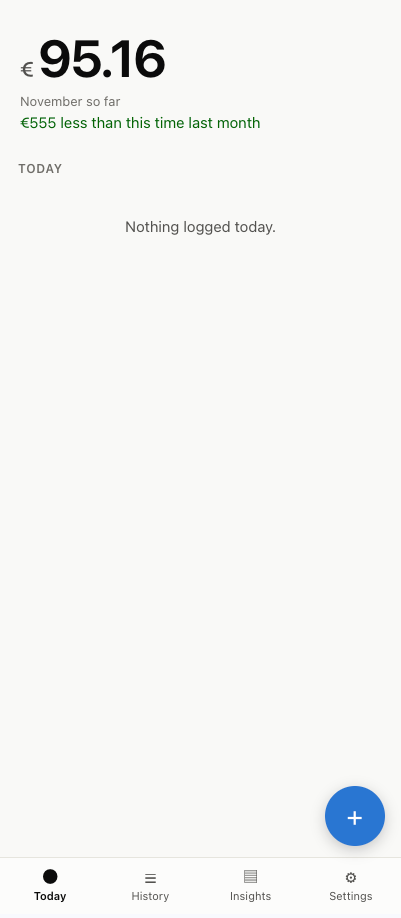
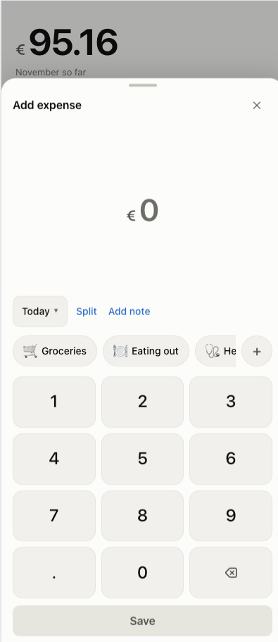
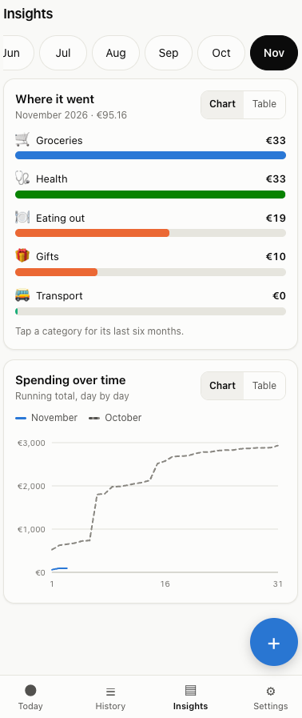

# Spend

Log what you spend, by hand. No account, no sign-up, no internet needed. Everything stays
on your device.

**Use it now → https://spend-gilt-ten.vercel.app**

<p>
  
  
  
</p>

## What it does

- **Log fast** — type an amount, tap a category, done.
- **History** — every expense by day, with filters by month and category.
- **Insights** — where the money went, spending over time, and a short tip when
  something stands out.
- **Shared bills** — optional: log a bill paid from a joint account and count only your
  share (Settings → Shared expenses).
- **Backup** — export to JSON or CSV, and import from a backup or from another tracker.
- **Your month, your way** — pick the day your spending month starts.

> **Back up now and then.** Your expenses live only on this device. Clearing browser
> data, uninstalling the app, or losing the phone deletes them for good. Settings →
> export gives you a file you can import again.

## Get it on your phone

**Android** — download the `.apk` from the [latest release](../../releases/latest) on the
phone and open it. Android asks once for permission to install from your browser. New
releases install over the old one, so your expenses stay.

**iPhone / iPad** — open the link above in Safari, then Share → **Add to Home Screen**.
You get an icon, a full screen without browser bars, and it works offline. There is no
`.ipa` to download: Apple doesn't allow installing apps outside the App Store, so a real
iPhone build would need a paid Apple account. The home-screen version does the same job.

**Desktop** — the link works as-is. Chrome shows an install button in the address bar.

## Run it locally

```sh
npm install
npm run dev     # http://localhost:5173
npm run check   # types, tests, lints — run before pushing
npm run build   # production bundle
```

Other scripts and how the code is organised: see [CLAUDE.md](CLAUDE.md).

## Ship a change

- **Web** — push to `main`. Vercel deploys automatically.
- **Android** — tag a new version and push the tag. GitHub Actions builds, signs, and
  publishes the APK to a release.

```sh
git tag v1.0.3
git push --tags
```

The version number comes from the tag. Nothing is built on this machine — no Android SDK
needed.

## One-time Android signing setup

Every APK must be signed with the **same** key. If a build is signed with a different key,
Android refuses to install it over the old app, and uninstalling first wipes the user's
expenses.

```sh
npm run keystore   # creates release.p12 and keystore-secrets.txt (both gitignored)
```

Copy the three values from `keystore-secrets.txt` into the repo's
Settings → Secrets and variables → Actions:

| Secret | |
| --- | --- |
| `ANDROID_KEYSTORE_BASE64` | the key file, base64-encoded |
| `ANDROID_KEYSTORE_PASSWORD` | generated password |
| `ANDROID_KEY_ALIAS` | `spend` |

Then save `release.p12` and the password in a password manager and delete
`keystore-secrets.txt`. **Lose that key and you can never update the app again** — users
would have to uninstall and lose their data.

Without the secrets the build still runs but produces an unsigned APK that Android won't
install.

## Testing on a real phone

Worth checking by hand after a change:

1. Add to Home Screen on iPhone Safari and Android Chrome.
2. Turn on airplane mode, close the app, reopen — everything still works.
3. Export your data, delete it all, import it back.
4. Switch the phone between light and dark mode.

`npm run preview:lan` serves the app to a phone on the same Wi-Fi. In dev builds,
Settings → Development can load sample data so the charts have something to show.
